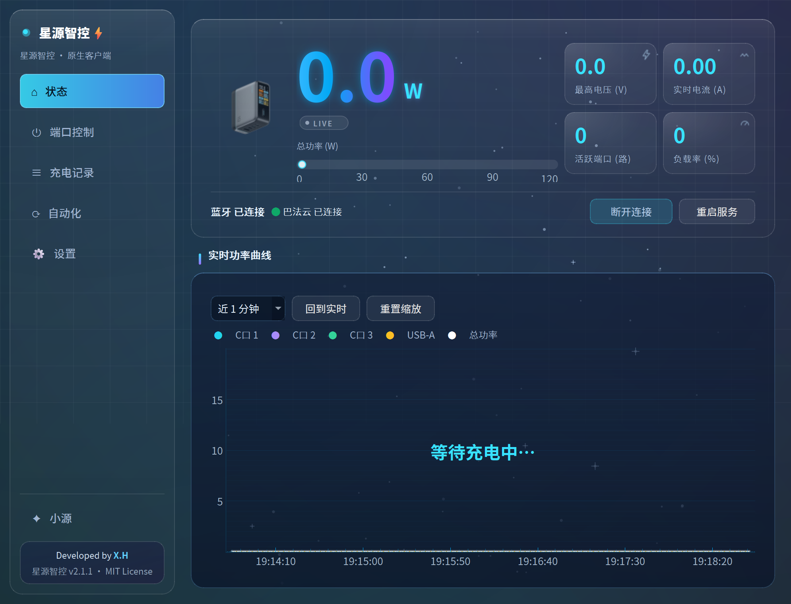
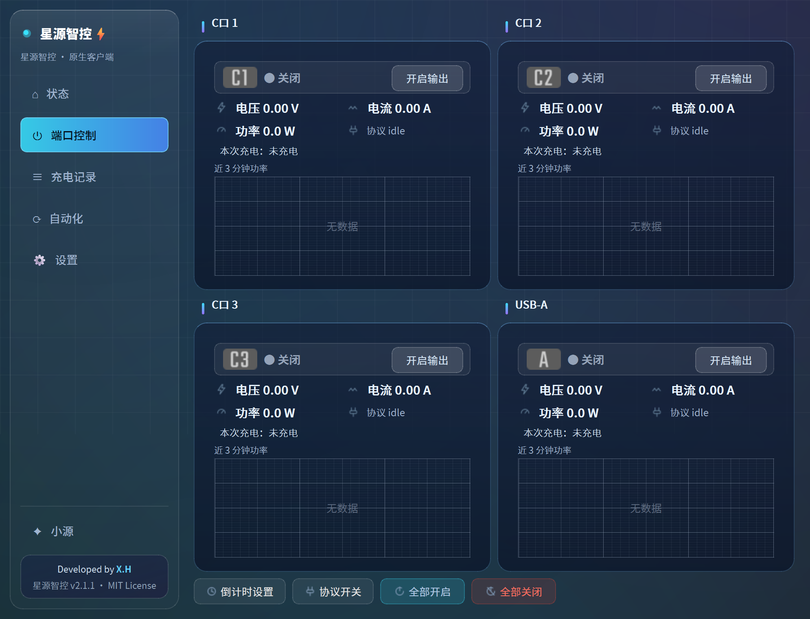
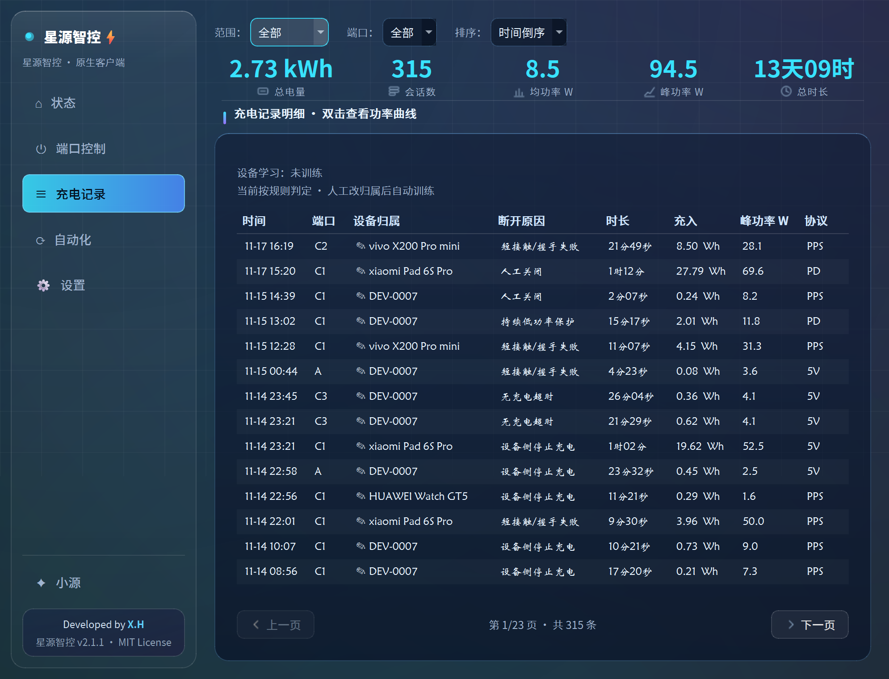
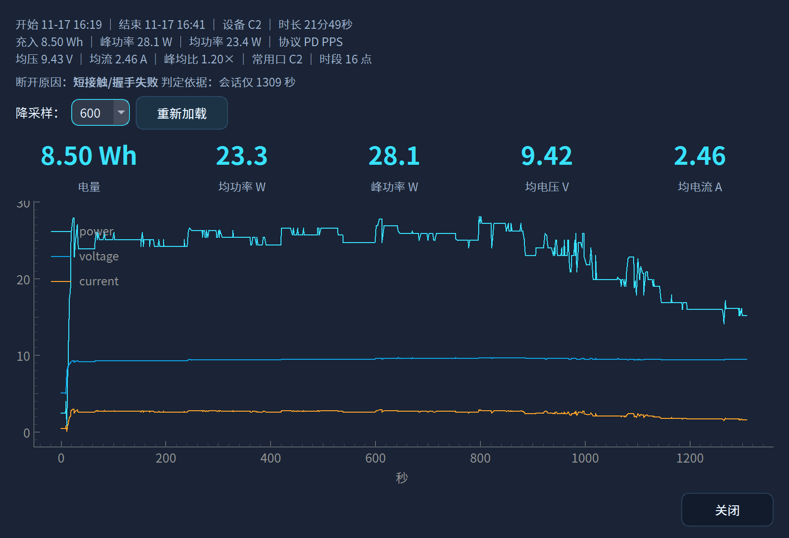
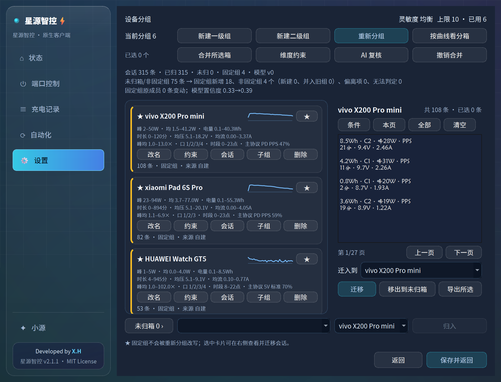
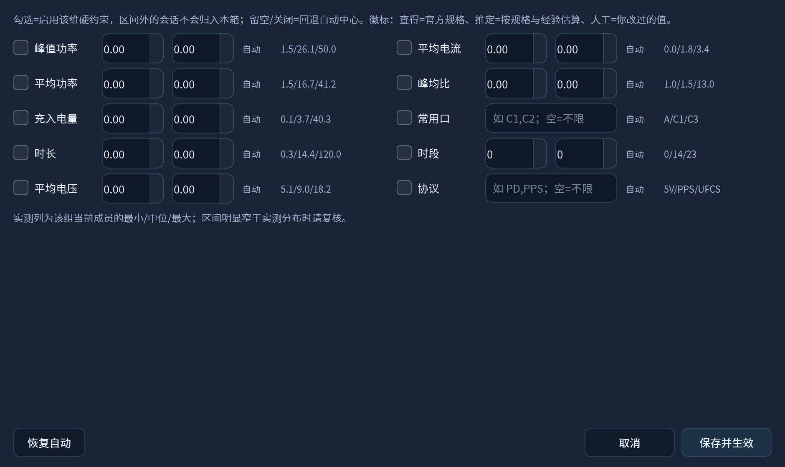
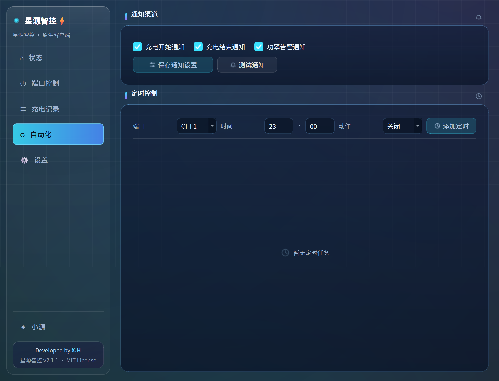
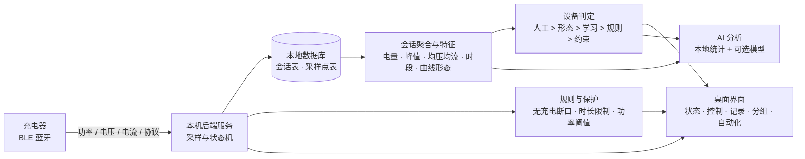

# 星源智控

**星源智控** 是面向酷态科（Cuktech）多口充电器的 Windows 桌面控制台：在本机完成实时监控、逐口控制、充电记录、曲线分箱与自动化保护，需要时再接入 AI 问答与 MQTT。

由 **X.H 团队** 开发与运营 · 当前版本 **2.1.1** · [MIT License](docs/LICENSE)

## 目录

- [核心能力](#核心能力)
- [架构与数据流](#架构与数据流)
- [安装与首次配置](#安装与首次配置)
- [数据与隐私](#数据与隐私)
- [版本与更新记录](#版本与更新记录)
- [许可证](#许可证)

## 核心能力

### 实时状态与曲线

状态页把四个端口合并到一张实时功率图上：总功率、逐口功率、电压电流与协议在同一屏内刷新。曲线按时间窗回看，可切「近 1 分钟 / 近 5 分钟 / 全部」，也能「回到实时」「重置缩放」。采样与绘图都在本机完成，断网不影响。

### 逐口控制

C 口 1/2/3 与 USB-A 独立开关，点一次即下发并回读确认；支持协议切换、倒计时关闭与「全部开启 / 全部关闭」。每张卡常驻一条近 3 分钟功率曲线，空载时保留网格占位，不再整块留白。

### 充电记录

每次插拔都会落成一条会话：时间、端口、协议、设备归属、断开原因、时长、充入电量、峰值功率。可按时间范围、端口、设备筛选，双击任意一条查看该次会话的曲线与均压、均流、峰均比、常用口、时段、协议等特征。

### 协议识别

采集侧已记录会话协议（PD / PPS / QC / UFCS / 5V），记录列表以短码展示、悬停看全称，明细页直接给出完整协议名；未握手或空闲会话记为「未知协议」，不做猜测。协议同时用于分组页的候选行与会话行，帮助人工校正归属。

### 设备分组与分箱

按充电曲线形态把会话自动归档：固定组保持稳定，不因「重新分组」被删改；未归位记录可进固定组、并入其它组或另起非固定组；明显偏离的记录单独隔离，「判不了」的统一进「无法判定」。分组页可改名、设约束、迁移成员、合并与撤销。候选行末列与组卡片会标出「主协议 + 占比」，协议也可作为可选约束维度，勾选后才参与过滤。

### 学习模型与人工纠正

判定链固定为「人工 > 形态 > 学习 > 规则 > 约束兜底」。人工迁移、改名、合并与 AI 建议采纳都会回流为训练样本，模型版本随累计训练次数前进；每次重新分组结束即落库重训，下次判定更贴近你的设备。特征只使用数值口径（功率、电量、时长、均压均流、时段、端口、峰均比与曲线形态），协议不编码、不参与训练，只辅助人工校正与分组判断。约束默认不预置，要不要设、设哪一维完全由你决定，且随时可清空。

### AI 分析与小源

内置本地规则分析：设备识别、断开原因分布、电压体检、单设备充电习惯与建议，全部离线可算。配置模型后可让「小源」用自然语言解读日报与异常；AI 复核会给出分箱建议，但不直接改数据，点「一键采纳」才落库并留审计。

### 自动化与保护

无充电自动关端口、A 口小电流自动保持、充电时长上限、低功率保护、过温与过功率阈值都可在界面内调整。无充电关端口的判定时长可调（默认 10 分钟），USB-A 默认豁免；所有触发与结束都写入本机日志。

### MQTT / 巴法云接入

在「设置 → 连接设置」填写巴法云私钥与设备信息后，状态与开关可经 MQTT 同步到其它终端；未配置或连接失败时自动留在本地模式，不影响蓝牙控制与记录。接入步骤见 [安装与配置](docs/安装与配置.md)。

## 架构与数据流

- **数据采集**：后端经 BLE 读取端口遥测，按端口维护状态机与采样节拍。
- **落库**：插拔区间聚合为会话，采样点按会话归档到本地 SQLite。
- **特征**：会话级统计（电量、峰值、均压/均流、峰均比、时段）与曲线形态向量。
- **判定**：人工归属优先，其次形态匹配、学习模型、规则，最后才是用户自设约束。
- **UI**：状态、控制、记录、分组、自动化共用同一份后端数据，跨页刷新读取同一模型。

模块职责与目录结构见 [架构说明](docs/架构说明.md)。

## 安装与首次配置

1. 运行安装包，按向导完成安装（默认装到当前用户目录，无需管理员权限）。
2. 首次启动会展示隐私说明与用户协议；不同意只停用 AI，离线功能仍可用。
3. 打开「设置 → 连接设置」，按「快速接入」四步填入蓝牙地址、Token 与密钥，点「连接设备」验证后保存。
4. 需要 MQTT 时再填巴法云信息；不需要就保持关闭，程序不会主动外连。

便携版解压即用，数据目录与安装版一致。完整步骤见 [安装与配置](docs/安装与配置.md)。

## 数据与隐私

- 充电记录、配置与学习模型都保存在本机 `%LOCALAPPDATA%\CuktechPanel`，不上传。
- 不启用 AI 时，端口控制、状态、记录与自动关闭全部在本机运行、不联网。
- 启用 AI 后只发送脱敏后的统计与问题文本，不发送蓝牙密钥、Token 与原始采样点。
- 卸载不会自动删除历史库；需要彻底清理时手动删除上述目录。

数据授权按项开关：关掉哪一项，哪一类数据就不进入 AI 上下文；脱敏开启时只发送聚合特征。任何时候都不发送原始高频曲线、端口开关与功率、设备 MAC/序列号、API Key 明文与诊断日志原文。

更多口径见 [功能说明](docs/功能说明.md) 与 [FAQ](docs/FAQ.md)。

## 版本与更新记录

当前版本 **2.1.1**。从 1.5.5 到 2.1.1 的主要变化（品牌统一、分组与学习重做、AI 一键采纳、曲线修复、约束不默认、协议展示与可选约束等）见 [CHANGELOG](docs/CHANGELOG.md)。

## 许可证

本项目代码采用 **MIT License**（`Copyright (c) 2026 X.H`），全文见 [LICENSE](docs/LICENSE)。

随包使用的第三方组件（PySide6 / Qt、pyqtgraph、numpy、aiohttp、bleak、paho-mqtt 等）各按其许可证分发，清单与履行方式见 [THIRD_PARTY_NOTICES](docs/THIRD_PARTY_NOTICES.md)；安装目录与便携包内另附 `LICENSES/` 原文。
