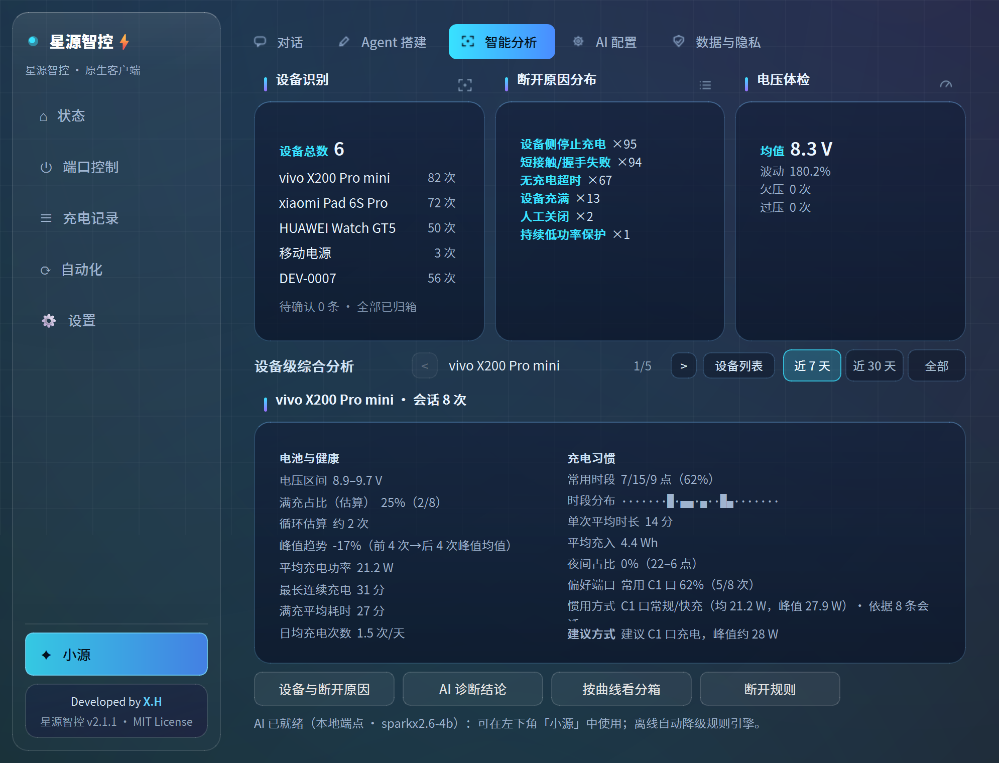
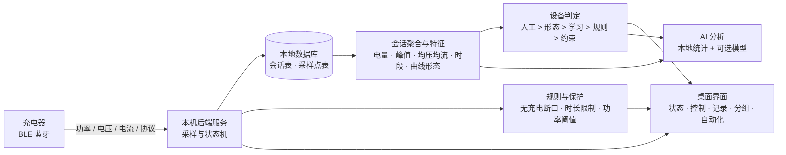
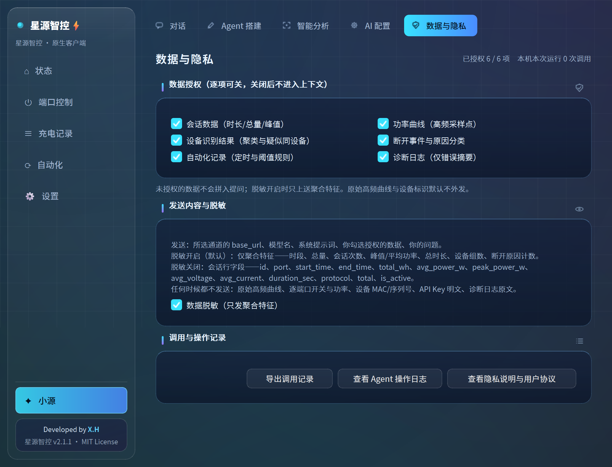

# 星源智控

**星源智控** 是面向酷态科（Cuktech）多口充电器的 Windows 桌面控制台：本机完成实时监控、逐口控制、充电记录、曲线分箱与自动化保护，需要时再接入 AI 问答与 MQTT。

由 **X.H 团队** 开发与运营 · 当前版本 **2.1.1** · [MIT License](docs/LICENSE)

<p align="center">
  
</p>
<p align="center"><em>图 1　状态页：四口总功率与逐口功率同屏，曲线支持时间窗切换与缩放</em></p>

## 目录

1. [概览](#1-概览)
2. [核心能力](#2-核心能力)
3. [架构与数据流](#3-架构与数据流)
4. [安装与首次配置](#4-安装与首次配置)
5. [数据与隐私](#5-数据与隐私)
6. [致谢](#6-致谢)
7. [许可证](#7-许可证)
8. [版本与更新记录](#8-版本与更新记录)

## 1. 概览

- **定位**：把充电器的实时状态、逐口控制与充电历史收进一个本地桌面应用。
- **本地优先**：采样、落库、判定与曲线绘制都在本机完成，断网不影响离线功能。
- **可解释**：分组判定按「人工 > 形态 > 学习 > 规则 > 约束」逐级给出依据，AI 建议需人工采纳才落库。

## 2. 核心能力

### 2.1 实时状态与曲线

四个端口合并到一张实时功率图，总功率、逐口功率、电压电流与协议同屏刷新。

- 曲线可切「近 1 分钟 / 近 5 分钟 / 全部」，支持「回到实时」与「重置缩放」。
- 采样与绘图在本机完成，不依赖网络。

<p align="center"></p>
<p align="center"><em>图 2　状态页：实时功率曲线与端口读数</em></p>

### 2.2 逐口控制

C 口 1/2/3 与 USB-A 独立开关，点一次下发并回读确认。

- 支持协议切换、倒计时关闭与「全部开启 / 全部关闭」。
- 每张端口卡常驻近 3 分钟功率曲线，空载时保留网格占位。

<p align="center"></p>
<p align="center"><em>图 3　端口控制：独立开关、协议切换与倒计时</em></p>

### 2.3 充电记录

每次插拔落成一条会话，列表展示时间、端口、协议、设备归属、断开原因、时长、充入电量与峰值功率。

- 可按时间范围、端口、设备筛选。
- 双击会话查看该次曲线与均压、均流、峰均比、常用口、时段、协议。

<p align="center"></p>
<p align="center"><em>图 4　充电记录：协议列以短码展示，悬停看全称</em></p>

### 2.4 协议识别

采集侧记录会话协议（PD / PPS / QC / UFCS / 5V），记录列表与分组候选均以短码展示，明细页给出全称。

- 未握手或空闲会话记为「未知协议」，不做推断。
- 协议只用于展示、人工校正与可选约束，不进入模型特征。

<p align="center"></p>
<p align="center"><em>图 5　会话明细：曲线与均压、均流、峰均比、协议等特征</em></p>

### 2.5 设备分组与分箱

按充电曲线形态自动归档：固定组保持稳定，不因重新分组被删改。

- 未归位记录可进固定组、并入其它组，或另起非固定组。
- 明显偏离的记录单独隔离，「判不了」的统一进「无法判定」。
- 组卡片显示「主协议 + 占比」；协议可作为可选约束维度。

<p align="center"></p>
<p align="center"><em>图 6　设备分组：候选行含协议列，卡片显示主协议占比</em></p>

### 2.6 学习模型与人工纠正

判定链固定为「人工 > 形态 > 学习 > 规则 > 约束兜底」。

- 人工迁移、改名、合并与 AI 建议采纳都会回流为训练样本。
- 特征只使用数值口径（功率、电量、时长、均压均流、时段、端口、峰均比与曲线形态）。
- 协议不编码、不参与训练，只辅助人工判断。

<p align="center"></p>
<p align="center"><em>图 7　维度约束：协议为可选维度，默认不勾选</em></p>

### 2.7 AI 分析与小源

内置本地规则分析：设备识别、断开原因分布、电压体检、单设备充电习惯与建议，全部离线可算。

- 配置模型后，可让「小源」用自然语言解读日报与异常。
- AI 复核给出分箱建议，但不直接改数据；点「一键采纳」才落库并留审计。

<p align="center"></p>
<p align="center"><em>图 8　智能分析：设备识别、断开原因、电压体检与单设备习惯</em></p>

### 2.8 自动化与保护

无充电自动关端口、A 口小电流自动保持、充电时长上限、低功率保护、过温与过功率阈值均可在界面内调整。

- 无充电关端口的判定时长可调（默认 10 分钟），USB-A 默认豁免。
- 所有触发与结束都写入本机日志。

<p align="center"></p>
<p align="center"><em>图 9　自动化与保护：阈值、延时与端口豁免</em></p>

### 2.9 MQTT / 巴法云接入

在「设置 → 连接设置」填写巴法云私钥与设备信息后，状态与开关可经 MQTT 同步到其它终端。

- 未配置或连接失败时自动留在本地模式。
- MQTT 默认关闭，不影响蓝牙控制与记录。

## 3. 架构与数据流



- **数据采集**：后端经 BLE 读取端口遥测，按端口维护状态机与采样节拍。
- **落库**：插拔区间聚合为会话，采样点按会话归档到本地 SQLite。
- **特征**：会话级统计与曲线形态向量。
- **判定**：人工归属优先，其次形态匹配、学习模型、规则，最后是用户自设约束。
- **UI**：各页共用同一份后端数据，跨页刷新读取同一模型。

模块职责与目录结构见 [架构说明](docs/架构说明.md)。

## 4. 安装与首次配置

1. 运行安装包，按向导完成安装（默认装到当前用户目录，无需管理员权限）。
2. 首次启动会展示隐私说明与用户协议；不同意只停用 AI，离线功能仍可用。
3. 打开「设置 → 连接设置」，按「快速接入」四步填入蓝牙地址、Token 与密钥，点「连接设备」验证后保存。
4. 需要 MQTT 时再填巴法云信息；不需要就保持关闭，程序不会主动外连。

```text
安装版：CuktechPanel-2.1.1-setup-win64.exe
便携版：解压 CuktechPanel-2.1.1-portable-win64.zip，运行 CuktechPanel.exe
```

便携版与安装版使用同一数据目录。完整步骤见 [安装与配置](docs/安装与配置.md)。

## 5. 数据与隐私

- 充电记录、配置与学习模型保存在本机 `%LOCALAPPDATA%\CuktechPanel`，不上传。
- 不启用 AI 时，端口控制、状态、记录与自动关闭全部在本机运行、不联网。
- 启用 AI 后只发送脱敏后的统计与问题文本，不发送蓝牙密钥、Token 与原始采样点。
- 数据授权按项开关；脱敏开启时只发送聚合特征。
- 卸载不会自动删除历史库；需要彻底清理时手动删除上述目录。

任何时候都不发送原始高频曲线、端口开关与功率、设备 MAC/序列号、API Key 明文与诊断日志原文。

<p align="center"></p>
<p align="center"><em>图 10　数据与隐私：逐项授权与发送内容说明</em></p>

更多口径见 [功能说明](docs/功能说明.md) 与 [FAQ](docs/FAQ.md)。

## 6. 致谢

本项目的 BLE 接入、会话落库与巴法云接入起步于下列公开实现；分组判定、学习模型、桌面界面与自动化为本项目实现。逐条说明用了什么、改了什么。

### 6.1 参考项目

- **[Dream-Architect1026/cuktech-ble-server](https://github.com/Dream-Architect1026/cuktech-ble-server)**（MIT）
  - 用到：MiOT BLE 通道划分与认证/命令帧、会话与采样点两表结构、巴法云配置项与 topic 用法。
  - 改动：由 Web 控制台改为 PySide6 桌面端；新增分箱、学习模型、自动化与本地 AI 分析；MQTT 默认关闭，失败回退本地。
  - 未改：蓝牙认证与命令帧格式、巴法云 topic 约定。
- **[zhyzhaogit/cuktech-ble-controller](https://github.com/zhyzhaogit/cuktech-ble-controller)**（MIT）
  - 用到：GATT 服务/特征与命令帧的字段定义，作为协议实现的对照。
  - 改动：按本项目结构重写，未复制代码。
- **[zuyan9/ha-cuk-ble](https://github.com/zuyan9/ha-cuk-ble)**（Apache-2.0）
  - 用到：协议检测（PD / PPS / QC / UFCS / 5V 判定）的判定顺序与档位依据。
  - 改动：仅保留展示用字段，未引入其 Home Assistant 集成代码。
- **[kairui1108/cuktech-ble-server](https://github.com/kairui1108/cuktech-ble-server)**
  - 说明：上述参考项目的上游，仓库未声明许可证；本项目只参考思路与协议事实，未复制其代码。
- **[PiotrMachowski/Xiaomi-cloud-tokens-extractor](https://github.com/PiotrMachowski/Xiaomi-cloud-tokens-extractor)**
  - 用到：安装文档中获取设备 MAC / Token / BLE Key 的操作指引；工具本身不随包分发。

### 6.2 第三方组件

实际随包使用的库与许可证见 [THIRD_PARTY_NOTICES](docs/THIRD_PARTY_NOTICES.md)：PySide6 / Qt（LGPL-3.0）、pyqtgraph（MIT）、numpy（BSD-3-Clause）、aiohttp（Apache-2.0）、bleak（MIT）、paho-mqtt（BSD-3-Clause）、requests、PyYAML、cryptography 等。

### 6.3 引用边界

- 被引用部分遵循原项目许可证；本项目的 MIT **不覆盖**被引用部分。
- 未修改任何第三方库源码；对参考实现的改动已在 6.1 逐条注明。

## 7. 许可证

本项目代码采用 **MIT License**（`Copyright (c) 2026 X.H`），全文见 [LICENSE](docs/LICENSE)。

随包第三方组件各按其许可证分发，清单与履行方式见 [THIRD_PARTY_NOTICES](docs/THIRD_PARTY_NOTICES.md)；安装目录与便携包内另附 `LICENSES/` 原文。

## 8. 版本与更新记录

当前版本 **2.1.1**。从 1.5.5 到 2.1.1 的主要变化见 [CHANGELOG](docs/CHANGELOG.md)：品牌统一、分组与学习重做、AI 一键采纳、曲线修复、约束不默认、协议展示与可选约束。
